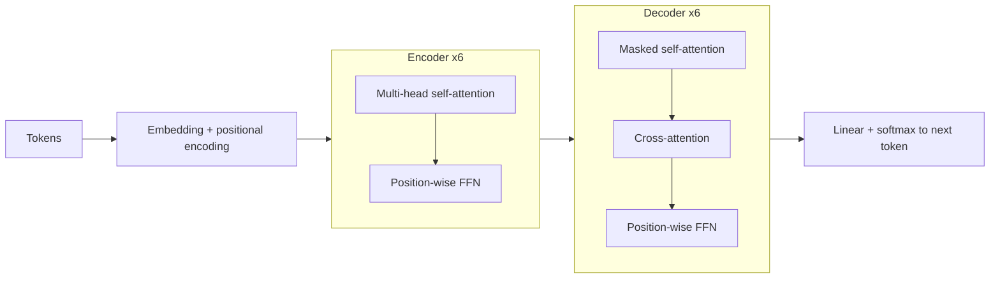

## 1. At a glance

**About.** RNN sequence models process tokens one at a time — inherently sequential
(no within-example parallelism) and long-range dependencies decay. The **Transformer**
drops recurrence and convolutions and builds the model from **attention** alone, so
every position attends to every other in one parallel step.

**Used:** scaled dot-product **self-attention** · **multi-head** attention · **encoder–
decoder** stack · **sinusoidal positional encodings** · position-wise **FFN** · residual
+ **LayerNorm** · Adam with a warmup LR schedule · label smoothing · dropout.

**Achieved ✓** — WMT-2014 SOTA: **28.4 BLEU** EN→DE (+2.0 over prior best), **41.8
BLEU** EN→FR, at a fraction of prior training cost; base trains in **12 h on 8 P100s**;
also SOTA-competitive English constituency parsing (**91.3 / 92.7 F1**).

**Didn't ✗** — self-attention is **O(n²)** in sequence length (flagged as future work,
e.g. restricted/local attention); demonstrated on translation + parsing only, not yet
the general pretraining recipe BERT/GPT would become; no analysis of very long context.

## 2. Building blocks

> [!warning] Background — general knowledge, not paper claims

- **RNN / recurrence** — prior default; step *t* depends on *t-1*, blocking parallelism
  and decaying long-range gradients. Removing it is the motivation.
- **Attention (Q/K/V)** — each token forms a **query**; every token exposes a **key**
  and **value**; output = value average weighted by query·key match.
- **Positional encoding** — attention is order-agnostic, so position is injected (here
  fixed sinusoids of varying frequency).
- **Residual + LayerNorm** — `LayerNorm(x + Sublayer(x))`, standard deep-net stabilizer.
- **Label smoothing** — soften one-hot targets so the model is less over-confident.
- **BLEU** — n-gram overlap translation metric; higher is better.

## 3. Architecture & method

**Core operation** — scaled dot-product attention; **multi-head** runs *h* of these in
parallel on learned projections, then concatenates:

$$
\text{Attention}(Q, K, V) = \text{softmax}\!\left(\frac{QK^{\top}}{\sqrt{d_k}}\right)V
$$

Steps — input → what they do → output:

1. **Embed + position** — token ids → `d_model` vectors + sinusoidal positions.
2. **Encoder (×6)** — each layer: multi-head **self**-attention → position-wise FFN
   (`max(0, xW₁+b₁)W₂+b₂`, inner dim `d_ff`), both wrapped in residual+LayerNorm.
3. **Decoder (×6)** — **masked** self-attention (no peeking ahead) → **cross**-attention
   over the encoder output → FFN.
4. **Project** — linear + softmax over the vocabulary → next token (weights tied with
   the embeddings).

**Two sizes:** base = `N=6, d_model=512, d_ff=2048, h=8, d_k=d_v=64, P_drop=0.1`;
big = `d_model=1024, d_ff=4096, h=16, P_drop=0.3` (EN-FR).

> [!key] Ground reality
> Three details make "just attention" work: **√dₖ scaling** (large `d_k` flatlines
> softmax gradients), **multi-head** (separate heads track different relations at once),
> and the decoder **causal mask** (parallel training that stays autoregressive).

## 4. Training & data

- **Data** — WMT-2014 **EN-DE** ~4.5M sentence pairs (shared **BPE** vocab ~37k) and
  **EN-FR** 36M sentences (word-piece vocab 32k). Batched by ~**25k source + 25k target
  tokens** per batch.
- **Optimizer** — Adam, **β₁=0.9, β₂=0.98, ε=10⁻⁹**, with the warmup schedule:

$$
\text{lrate} = d_{\text{model}}^{-0.5}\cdot \min\!\left(\text{step}^{-0.5},\ \text{step}\cdot \text{warmup}^{-1.5}\right),\quad \text{warmup}=4000
$$

  (linear warmup for 4000 steps, then inverse-√ decay).
- **Regularization** — residual dropout `P_drop=0.1` (0.3 for the big EN-FR model),
  attention/embedding dropout, **label smoothing ε_ls=0.1** (hurts perplexity but
  improves BLEU).
- **Hardware/steps** — 8× P100; **base** 100k steps ≈ 12 h (0.4 s/step); **big** 300k
  steps ≈ 3.5 days (1.0 s/step). Averaged the last checkpoints.

## 5. Results, ablations & limitations

| Task (WMT-2014) | base | big |
| --- | --- | --- |
| EN→DE BLEU | 27.3 | **28.4** (prior ensemble 26.36) |
| EN→FR BLEU | 38.1 | **41.8** |

**Ablations (Table 3).** Single head is ~0.9 BLEU worse, but too many heads also hurt;
reducing `d_k` hurts (compatibility isn't a trivial dot product); **bigger models +
dropout help**; **learned positional embeddings ≈ sinusoidal** (sinusoids chosen for
length extrapolation).

**Beyond translation.** English constituency parsing: **91.3 F1** (WSJ-only), **92.7 F1**
(semi-supervised) — strong without task-specific tuning.

**Limitations.** Self-attention is **O(n²·d)** per layer — fine for sentences, costly
for long sequences (authors suggest restricted/local attention as future work); results
are translation/parsing only.

## 6. Questions worth asking

- How far can sequence length scale before O(n²) attention dominates — and which
  efficient-attention approximations keep quality?
- How much of the win is attention vs. simply removing the sequential bottleneck?
- Sinusoidal vs. learned vs. rotary positions — when does length-extrapolation break?
- Shared backbone of [[retrieval-augmented-generation]] and
  [[moshi-speech-text-foundation-model]] — what changes when "tokens" are passages or audio?
