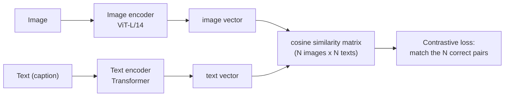

## 1. At a glance

**About.** Normal vision models are trained to predict a *fixed* list of labels — add a
new class and you need new labeled data. CLIP instead learns from **raw (image, caption)
pairs off the web**. It trains an image encoder and a text encoder to land matching pairs
near each other in one shared space. Afterward you classify **zero-shot**: embed the
candidate class names as text and pick the nearest one — no fine-tuning, no fixed label set.

**Used:** **contrastive** image–text pretraining · image encoder (**ViT-L/14** or big
ResNets) + **Transformer** text encoder · **400M** web pairs (WIT) · prompt engineering.

**Achieved ✓** — **76.2%** zero-shot ImageNet top-1 (**matches supervised ResNet-50**
using *none* of its 1.28M labels); strong across 30+ datasets; far more **robust to
distribution shift** (closes up to 75% of the robustness gap).

**Didn't ✗** — weak on **fine-grained** classes, **counting**, and abstract tasks (only
88% on MNIST — beaten by logistic regression on raw pixels); **prompt-sensitive**;
reaching overall SOTA would need ~**1000×** more compute.

## 2. Building blocks

> [!warning] Background — general knowledge, not paper claims

- **Contrastive learning** — don't predict a label; learn an embedding space where
  "things that belong together" are close and everything else is far.
- **Embedding space** — a vector space where similarity = closeness (cosine). CLIP puts
  *images and text in the same one*, so you can compare a photo to a sentence.
- **Zero-shot** — doing a task with **no** task-specific training examples.
- **Prompt engineering** — wording the class as a sentence ("a photo of a dog") rather
  than a bare word, which matches the caption style CLIP trained on.

## 3. Architecture & method

**Big idea.** In a batch of **N** (image, text) pairs there are **N correct** matches and
**N²−N** wrong ones. Train so each image's vector has **high cosine similarity** with its
own caption and low with all others — a **symmetric cross-entropy** over the similarity
matrix (InfoNCE-style). A learned **temperature** scales the logits (init ≈ 0.07, capped).

**Zero-shot inference.** Encode each class name as a prompt ("A photo of a {label}."),
encode the image, and pick the class whose text vector is nearest. The prompt template
alone adds **+1.3%** on ImageNet; **ensembling 80 prompts** adds **+3.5%** (≈5% total).

> [!key] Why web captions beat labels
> A caption is far richer supervision than a one-of-1000 label, and it's free at web
> scale. Language also lets you describe *new* concepts at test time — that's what makes
> open-vocabulary, zero-shot classification possible.

## 4. Training & data

- **Data** — **WIT**: 400M (image, text) pairs, built from 500k queries, capped at 20k
  pairs/query for balance.
- **Encoders** — image: ResNet (RN50 → RN50x64) or ViT (B/32, B/16, **L/14**); best is
  **ViT-L/14 @ 336px**. Text: 12-layer, 512-wide Transformer, 8 heads (63M params),
  76-token max.
- **Optimizer** — Adam (decoupled weight decay), cosine LR, **batch 32,768**, **32
  epochs**, mixed precision.
- **Compute** — largest ResNet: 18 days on **592 V100s**; largest ViT: 12 days on **256
  V100s**.

## 5. Results, ablations & limitations

| Aspect | Result |
| --- | --- |
| Zero-shot ImageNet | **76.2%** top-1 (= supervised ResNet-50, zero labels) |
| Robustness | closes up to **75%** of the accuracy gap under distribution shift |
| Linear probe | beats Noisy-Student EfficientNet-L2 on **21 / 27** datasets |

**Prompt engineering + ensembling** is a genuine lever (~+5% on ImageNet), which also
reveals fragility: results depend on wording.

**Limitations.** Poor at fine-grained distinctions, counting, and abstract/systematic
tasks; MNIST only 88%; adapting to ImageNet raises accuracy to 85.4% but *reduces*
average robustness; closing the gap to SOTA is estimated at ~1000× compute.

## 6. Questions worth asking

- How much of zero-shot success is genuine generalization vs. the test concepts simply
  appearing in 400M web captions (train/test overlap)?
- Why the counting / fine-grained weakness — a data problem or an objective problem?
- Could the contrastive objective be paired with a generative one for the best of both?
- The image tower is a [[vision-transformer|ViT]]; the pairing idea underlies modern
  robot VLMs like [[rt-2-vision-language-action|RT-2]] — what transfers?
