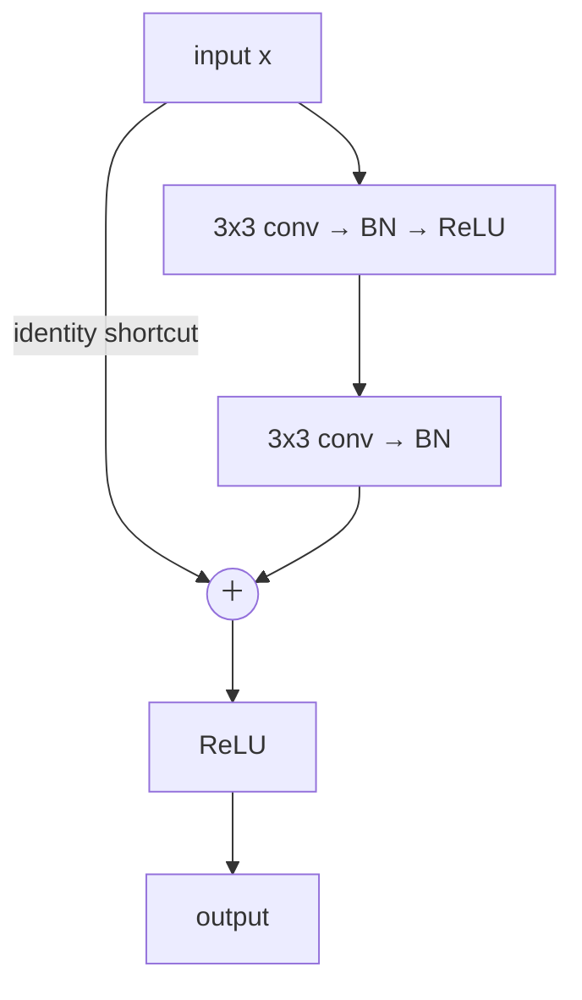

## 1. At a glance

**About.** Making CNNs deeper *should* help, but past a point deeper "plain" networks
got **worse — even on the training set**. That's not overfitting; it's an
*optimization* failure (the degradation problem). ResNet fixes it with a tiny change:
let each block learn a **residual** (a correction to its input) instead of a fresh
transformation — via a **skip connection** that adds the input straight to the output.

**Used:** stacked **residual blocks** (skip connections) · **BatchNorm** · bottleneck
blocks for deep variants · plain SGD. Depths **18 / 34 / 50 / 101 / 152**.

**Achieved ✓** — ImageNet winner 2015: **3.57%** top-5 error (ensemble); ResNet-152
single model **19.38% / 4.49%** top-1/top-5; trained nets **8× deeper than VGG** with
*lower* complexity; +28% relative COCO detection.

**Didn't ✗** — doesn't explain *why* plain deep nets fail to optimize (left open);
extreme depth can overfit small data (the 1202-layer CIFAR net is worse than 110);
no dropout / heavy regularization explored.

## 2. Building blocks

> [!warning] Background — general knowledge, not paper claims

- **CNN** — a network of learned convolution filters that detect visual patterns
  (edges → textures → objects) layer by layer.
- **The degradation problem** — stacking more layers eventually *raises* training
  error. Intuition: a deep stack struggles to even learn the identity function, so
  extra layers can make a working shallow net worse.
- **BatchNorm** — normalizes each layer's activations per mini-batch; stabilizes and
  speeds up training of deep nets.
- **Top-1 / top-5 error** — top-1: the single prediction is wrong; top-5: the true
  label isn't in the model's 5 best guesses.

## 3. Architecture & method

**Big idea.** Instead of asking a block to learn a target mapping $H(x)$ directly, ask
it to learn the **residual** $F(x) = H(x) - x$, and recover the target as $F(x)+x$. If
the best thing a block can do is "leave the input alone," it just drives $F(x)\to 0$ —
trivial — so adding depth can never hurt.

$$
y = F(x, \{W_i\}) + x
$$

- **Identity shortcut** — adds $x$ unchanged (no extra parameters/compute). A
  **projection shortcut** $y = F(x) + W_s x$ is used only when dimensions change.
- **Bottleneck block** (ResNet-50/101/152) — `1×1 → 3×3 → 1×1`: the 1×1 convs shrink
  then restore channels so the 3×3 runs cheaply. Depths/compute: 18→34→50→101→152 at
  **1.8 / 3.6 / 3.8 / 7.6 / 11.3 GFLOPs**.
- **BatchNorm** right after each conv; **no dropout**.

> [!key] Why it works (the whole point)
> The skip connection gives gradients a direct path backward (no vanishing through
> dozens of layers) and reframes the task as "learn a small correction," which is far
> easier to optimize than "learn everything from scratch."

## 4. Training & data

- **Data** — ImageNet (1.28M images, 1000 classes). Augmentation: shorter side resized
  to a random value in **[256, 480]**, random **224×224** crop + horizontal flip,
  per-pixel mean subtraction, standard color augmentation.
- **Optimizer** — SGD, **batch 256**, momentum **0.9**, weight decay **1e-4**, LR
  starts at **0.1** and is **÷10 on plateau**, up to **60×10⁴** iterations.

## 5. Results, ablations & limitations

| Setting | Result |
| --- | --- |
| ImageNet ensemble (test) | **3.57%** top-5 error — 1st place ILSVRC 2015 |
| ResNet-152 single model | **19.38% / 4.49%** top-1/top-5 |
| COCO detection | VGG-16 21.2 → ResNet-101 **27.2** mAP (**+28%** relative) |

**The key ablation (plain vs residual).** Plain nets get *worse* with depth —
18→34 layers: top-1 error **27.94 → 28.54**. Residual nets get *better* —
**27.88 → 25.03**. Same depth, one change, opposite trend.

**Going extreme (CIFAR-10).** 110 layers → **6.43%** error; **1202 layers** still
*trains* fine (<0.1% train error) but tests **7.93%** — i.e., it **overfits**.

**Limitations.** The 1202-layer net is "unnecessarily large" for CIFAR and overfits;
the authors don't fully explain the optimization difficulty of plain nets; stronger
regularization is left as future work.

## 6. Questions worth asking

- Is the benefit mostly better gradient flow, or the "learn a small correction"
  reframing — and can you separate the two?
- Residual connections are now everywhere, including the
  [[attention-is-all-you-need|Transformer]] — is the mechanism identical there?
- BatchNorm + residuals interact; how much of ResNet's trainability is each?
- At what depth/data size do diminishing returns set in for pure depth?
