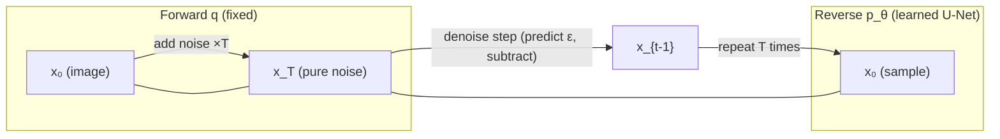

## 1. At a glance

**About.** DDPM generates images by **reversing a slow corruption**. A fixed *forward*
process adds a little Gaussian noise over many steps until the image is pure static. A
network learns the *reverse*: start from noise and **denoise step by step** back into a
sample. The key practical trick: train the network to **predict the noise** that was
added, with a plain squared-error loss.

**Used:** fixed **forward diffusion** · learned **reverse** denoiser · a **U-Net**
predicting noise ε · **T = 1000** steps.

**Achieved ✓** — SOTA image quality at the time: CIFAR-10 **FID 3.17**, Inception
**9.46**; high-quality 256×256 LSUN; training is stable (just an MSE loss).

**Didn't ✗** — **slow sampling** (needs ~**T=1000** sequential network passes — ~17s for
a batch of CIFAR images); **log-likelihood not competitive** (≤3.75 bits/dim vs 2.80 for
Sparse Transformer); learning the reverse variances was unstable (kept fixed).

## 2. Building blocks

> [!warning] Background — general knowledge, not paper claims

- **Generative model** — learns the data distribution so it can *sample* new, realistic
  examples (here, images).
- **Gaussian noise** — random values from a bell curve; "adding noise" nudges every
  pixel randomly. Enough steps → indistinguishable from static.
- **FID / Inception Score** — automatic image-quality metrics (lower FID = closer to
  real; higher IS = better).
- **U-Net** — an encoder-decoder CNN with skip connections, standard for
  image-to-image tasks; here it maps a noisy image + timestep → predicted noise.

## 3. Architecture & method

**Forward process (fixed, no learning).** Add noise per step; conveniently, you can jump
to any step $t$ in closed form (with $\alpha_t=1-\beta_t,\ \bar\alpha_t=\prod_{s\le t}\alpha_s$):

$$
q(x_t \mid x_0) = \mathcal{N}\!\left(x_t;\ \sqrt{\bar\alpha_t}\,x_0,\ (1-\bar\alpha_t)\mathbf{I}\right)
$$

**Reverse process (learned).** A U-Net predicts the noise $\varepsilon$ in $x_t$; the
training objective reduces to a simple MSE:

$$
L_{\text{simple}} = \mathbb{E}_{t,x_0,\varepsilon}\left\|\varepsilon - \varepsilon_\theta\!\left(\sqrt{\bar\alpha_t}\,x_0 + \sqrt{1-\bar\alpha_t}\,\varepsilon,\ t\right)\right\|^2
$$

Steps — input → what they do → output:

1. **Train** — take a real image, pick a random step $t$, add the corresponding noise,
   and train the U-Net to **predict that noise**. (Plain regression — very stable.)
2. **Sample** — start from pure noise $x_T$; for $t=T\dots1$, predict ε, subtract it to
   get a slightly cleaner $x_{t-1}$ (plus a little noise), repeat → a fresh image.

> [!key] Ground reality
> Two non-obvious choices do the heavy lifting: predicting the **noise** ε (not the
> image) gives a clean MSE objective, and **fixing** the reverse variances $\sigma_t^2$
> (learning them was unstable) made training reliable. This links to **score matching**
> — ε_θ behaves like a learned gradient of the data density, and sampling resembles
> Langevin dynamics.

## 4. Training & data

- **Architecture** — U-Net (Wide-ResNet style, group norm), **self-attention at 16×16**,
  **sinusoidal timestep embedding** added in each residual block. CIFAR model 35.7M params.
- **Schedule** — **T = 1000**, linear β from **1e-4 → 0.02**.
- **Optimizer** — Adam, LR **2e-4** (2e-5 at 256×256), EMA of weights (decay 0.9999).

## 5. Results, ablations & limitations

| Dataset | Result |
| --- | --- |
| CIFAR-10 (unconditional) | **FID 3.17**, Inception **9.46**, NLL ≤ 3.75 bits/dim |
| LSUN 256×256 | Bedroom FID 4.90, Church 7.89, Cat 19.75 |

**Objective ablation.** The *simplified* (unweighted) loss $L_{\text{simple}}$ produces
**better samples** than the full variational weighting — the paper's central empirical
finding.

**Limitations.** Sampling is slow (T sequential passes); log-likelihood lags dedicated
likelihood models; learned reverse variances were unstable so are fixed.

## 6. Questions worth asking

- Sampling needs ~1000 steps — how far can step count drop (DDIM, distillation) before
  quality falls off?
- Why does the *unweighted* loss beat the theoretically-motivated weighted bound?
- ε-prediction ≈ score estimation — when is the score-based view more useful than the
  denoising view?
- How does conditioning (text/class) plug in, and what changes for latent-space
  diffusion?
