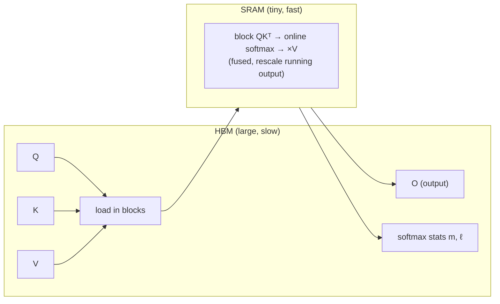

## 1. At a glance

**About.** Standard attention is slow not because of math but because of **memory
traffic**: it writes the giant `N×N` score matrix to slow GPU memory (HBM) and reads it
back. FlashAttention computes the **exact same attention** while **never materializing
that matrix** — it streams the computation in blocks through fast on-chip memory (SRAM).
The insight: attention is **memory-bandwidth-bound**, so the win comes from being
**IO-aware**.

**Used:** **tiling** + the **online-softmax** trick · **kernel fusion** (one CUDA
kernel) · **recomputation** in the backward pass. Exact attention.

**Achieved ✓** — up to **7.6×** faster attention; **GPT-2 3×** end-to-end, **BERT-large
15%** faster; memory **linear in N** (up to 20× less); enables long context — **Path-X
(16K)** and block-sparse **Path-256 (64K)**, previously intractable.

**Didn't ✗** — each attention variant needs a **hand-written CUDA kernel** (big
engineering effort, not portable across GPUs); multi-GPU IO-awareness left as future work.

## 2. Building blocks

> [!warning] Background — general knowledge, not paper claims

- **GPU memory hierarchy** — **SRAM** is tiny but ~**19 TB/s** (192 KB per SM × 108
  SMs on A100); **HBM** is large (40–80 GB) but ~**10× slower** (1.5–2 TB/s). Moving data
  between them is often the real bottleneck.
- **Memory-bound vs compute-bound** — an op is memory-bound when the chip waits on data
  movement rather than arithmetic. Softmax, dropout, masking are memory-bound.
- **Online (streaming) softmax** — compute softmax over a stream of blocks by keeping a
  running max and running sum, rescaling previous partial results — so you never need the
  whole row at once.
- **Kernel fusion** — do several steps in one GPU kernel so intermediates stay on-chip
  instead of round-tripping to HBM.

## 3. Architecture & method

**The problem, precisely.** Standard attention does `S=QKᵀ`, `P=softmax(S)`, `O=PV`, and
stores the `N×N` `S` and `P` in HBM → **O(N²) memory** and lots of slow reads/writes.

**The fix — three moves:**

1. **Tiling** — split Q, K, V into blocks; load a block into SRAM; compute its partial
   attention with **online softmax** (running max `m` and normalizer `ℓ`), rescaling the
   accumulated output as new blocks arrive. The exact softmax is recovered without ever
   holding the full row.
2. **Fusion** — matmul + softmax + mask + dropout + matmul run in **one kernel**, so the
   `N×N` intermediates never leave SRAM.
3. **Recomputation** — the forward pass stores only the output `O` and the small stats
   `(m, ℓ)`; the backward pass **recomputes** attention blocks in SRAM instead of reading
   a stored `N×N` matrix. Extra FLOPs, but far less HBM traffic → still faster.

> [!key] FLOPs aren't the metric — IO is
> FlashAttention does the *same or more* arithmetic but **fewer HBM accesses**:
> Θ(N²d²/M) vs standard Θ(N²+Nd) — up to **9×** fewer — and the paper proves this is
> optimal for a range of SRAM sizes. That's why it's faster despite being exact.

## 4. Implementation & setup

- **Exactness** — output equals standard attention bit-for-bit (not an approximation);
  extra memory beyond inputs/output is **O(N)**.
- **Block-sparse FlashAttention** — an approximate extension: skip blocks by a sparsity
  mask, cutting IO proportionally — **2–4×** faster again, enabling 64K-length Path-256.
- Implemented as fused CUDA kernels; integrated into training of BERT and GPT-2.

## 5. Results, ablations & limitations

| Workload | Speedup |
| --- | --- |
| Attention op (GPT-2) | up to **7.6×** vs PyTorch |
| GPT-2 end-to-end | **3×** (small: 2.7 vs 9.5 days) |
| BERT-large (MLPerf) | **15%** faster to target |
| Long-Range Arena | up to **2.4×** |

**Memory & context.** Memory grows **linearly** in sequence length (up to 20× less than
exact baselines). Longer context is now cheap *and* better: GPT-2 at 4K context is **0.7
perplexity** better than 1K while still 30% faster than a 1K Megatron run; **Path-X**
(16K) reaches 61.4%; block-sparse **Path-256** (64K) reaches 63.1%.

**Limitations.** Needs a bespoke CUDA kernel per attention variant and GPU generation
(hard to maintain/port); the authors call for a compiler from high-level code to IO-aware
kernels; multi-GPU is future work.

## 6. Questions worth asking

- How much of modern long-context LLMs is downstream of this one systems idea?
- Where's the ceiling — is attention still memory-bound after FlashAttention, or now
  compute-bound?
- The "optimize IO, not FLOPs" lesson generalizes — which other layers are secretly
  memory-bound?
- Serving systems like [[vllm-paged-attention|vLLM]] attack a *different* memory problem
  (KV-cache management) — how do the two compose? And does
  [[mamba-selective-state-spaces|Mamba]] sidestep the issue entirely?
