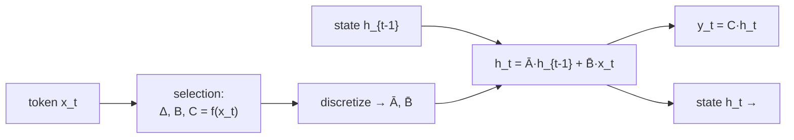

## 1. At a glance

**About.** Transformers are powerful but cost **O(N²)** to train and keep a growing **KV
cache** at inference. Older **state-space models (SSMs)** like S4 run in **linear time**
but underperform on language — because they're **time-invariant** (same fixed dynamics
every step), so they can't *choose* what to remember based on content. **Mamba** makes the
SSM **selective**: its parameters become **functions of the input**, so it can select,
ignore, or forget per token — recovering content-based reasoning while staying linear-time.

**Used:** **SSM** recurrence · a **selection mechanism** (input-dependent B, C, Δ) · a
**hardware-aware parallel scan** · a simplified **Mamba block** (H3 + gated MLP).

**Achieved ✓** — **~5× higher inference throughput** than Transformers, **linear** scaling
in length; **Mamba-3B matches Transformers 2× its size**; generalizes to **~1M-token**
sequences; strong on language, DNA, and audio.

**Didn't ✗** — selectivity breaks the convolution speedup (needs a custom scan kernel);
complex-valued SSMs help *continuous* data (audio) but not *discrete* (text/DNA); still a
newer architecture with a smaller ecosystem than attention.

## 2. Building blocks

> [!warning] Background — general knowledge, not paper claims

- **State-space model (SSM)** — carries a hidden **state** `h` through time: `h′=Ah+Bx`,
  `y=Ch`. Think of it as a continuous-time RNN; `A` controls how memory decays.
- **Discretization (Δ)** — a step size that turns the continuous system into a discrete
  recurrence you can run on sequences.
- **LTI (time-invariant)** — the dynamics (A, B, C) are **fixed** for all tokens. Fast,
  but it treats every token the same — it can't pay special attention to an important one.
- **Parallel scan** — a trick to compute a sequential recurrence in parallel across the
  sequence (so training isn't slow despite being recurrent).

## 3. Architecture & method

**SSM recap.** Continuous `(A,B,C)` discretized by `Δ` gives a recurrence
`hₜ = Ā hₜ₋₁ + B̄ xₜ`, `yₜ = C hₜ`. An LTI SSM can run either as a **recurrence** (great
for step-by-step inference) or as a **global convolution** (great for parallel training).

**The selection mechanism (the core idea).** Make **Δ, B, C** linear functions of the
input `xₜ` (Δ via softplus). Now the dynamics **change per token** — the model can let an
important token write strongly to state and a filler token barely at all. Mamba finds **Δ
is the most important** selective parameter; with N=1, A=−1, B=1 the recurrence reduces to
a **gated RNN**, tying Δ to classic gating.

> [!key] Ground reality: you lose the convolution, so you engineer the scan
> Input-dependent parameters make the model **time-varying**, which **breaks the
> convolution equivalence**. Mamba pays for this with a **hardware-aware selective scan**:
> keep the expanded state in **SRAM**, fuse discretization + recurrence, and **recompute**
> states in the backward pass instead of storing them — **20–40×** faster than a naive
> PyTorch scan, up to **3×** end-to-end on A100.

**Block.** Mamba fuses the H3-style SSM and a gated MLP into **one** repeated block
(expansion factor E=2, SiLU) — no attention, no separate MLP.

## 4. Training & data

- Benchmarked across **language** (The Pile), **DNA** (HG38 genome), and **audio**
  (SC09, YouTubeMix).
- Scaling studies vs strong Transformer recipes ("Transformer++") at matched sizes;
  state dimension and selective projections ablated.
- *Exact optimizer/LR/batch hyperparameters:* not extracted here (see paper appendix).

## 5. Results, ablations & limitations

| Aspect | Result |
| --- | --- |
| Inference throughput | **~5×** vs Transformers; linear in length |
| Language (Pile) | **Mamba-2.8B avg 63.3** vs Pythia-2.8B 59.1, Pythia-6.9B 61.7 |
| Scaling | Mamba-3B matches Transformers **2× its size** |
| Selective Copying | **99.8%** accuracy |
| Induction heads | generalizes to **~1M** tokens (≈4000× the 256 training length) |
| Audio (SC09) | **FID 0.67** (24.3M) vs SaShiMi 1.99 (5.8M) |

**Ablation.** Non-selective SSM variants perform similarly to each other; **adding
selectivity** is what drives the gains. Real-valued init works as well as complex for
language.

**Limitations.** Complex-valued SSMs help continuous modalities (audio) but not discrete
ones (text/DNA); the selective scan requires a custom kernel; newer ecosystem.

## 6. Questions worth asking

- Where does Mamba still trail attention — long-range *retrieval/copying* of exact
  tokens (where a KV cache shines)?
- Selectivity ≈ gating ≈ a form of soft attention over time — how deep is that equivalence?
- Hybrid stacks (a few attention layers + Mamba) vs pure Mamba — best of both?
- It removes the KV cache that [[vllm-paged-attention|vLLM]] works so hard to manage, and
  the quadratic cost [[flashattention|FlashAttention]] optimizes — does it make both moot,
  or just shift the bottleneck?
