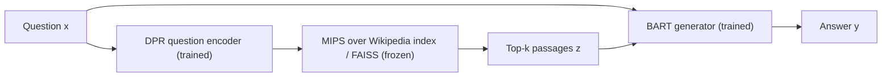

## 1. At a glance

**About.** LLMs store facts in their weights — hard to update, hard to attribute, prone
to hallucination. **RAG** adds a second memory: a searchable document index. It retrieves
passages and conditions generation on them, so facts live in an index you can swap out.

**Used:** **BART-large** (400M) generator · **DPR** dual-BERT retriever (pretrained on
NQ/TriviaQA) · **Wikipedia** index (21M passages, MIPS via FAISS) · variants **RAG-
Sequence** / **RAG-Token** · trained end-to-end on the answer alone.

**Achieved ✓** — open-domain QA SOTA (e.g. **Natural Questions 44.5 EM** vs DPR 41.5),
no gold-document supervision; more factual/specific generation (Jeopardy: factual
**42.7%** vs BART **7.1%**); knowledge **editable** by swapping the index (hot-swap test).

**Didn't ✗** — bottlenecked by **retrieval** (missed passage → unrecoverable); the
**document encoder/index is frozen** (only query encoder + generator train); **retrieval
collapse** on open-ended generation (retrieves the same docs regardless of input); some
tasks (MS-MARCO) aren't answerable from Wikipedia alone.

## 2. Building blocks

> [!warning] Background — general knowledge, not paper claims

- **Parametric vs. non-parametric memory** — knowledge in weights (fluent, static,
  opaque) vs. an external index (editable, attributable). RAG combines both.
- **BART** — Transformer encoder-decoder ([[attention-is-all-you-need]]) pretrained as a
  denoiser; writes the answer given query + retrieved text.
- **DPR** — two BERT encoders (question / passage) into a shared space; relevant pairs
  have high inner product. Semantic search, not keyword (BM25).
- **MIPS / FAISS** — Maximum Inner-Product Search over 21M passage vectors; FAISS makes
  it fast/approximate (HNSW).

## 3. Architecture & method

**Big idea.** Treat the retrieved document $z$ as a **latent variable**, marginalise over
the top-k, and train retriever + generator jointly on just the final answer — the model
learns which documents help without ever being told the "right" one.

$$
p_{\text{RAG-Seq}}(y\mid x) \approx \sum_{z\in\text{top-}k} p_\eta(z\mid x)\,p_\theta(y\mid x,z)
\quad
p_{\text{RAG-Tok}}(y\mid x) \approx \prod_i \sum_{z\in\text{top-}k} p_\eta(z\mid x)\,p_\theta(y_i\mid x,z,y_{<i})
$$

Steps — input → what they do → output:

1. **Encode query** — question → DPR question encoder → dense vector.
2. **Retrieve** — MIPS over the pre-encoded Wikipedia index → top-k passages.
3. **Generate** — BART conditions on query + passages → answer.
4. **Marginalise** — **RAG-Sequence** uses one document for the whole answer;
   **RAG-Token** can use a different document per token.

> [!key] Ground reality
> "Train end-to-end" hides the compromise: back-prop into the document encoder would mean
> re-indexing all 21M passages every step, so they **freeze the document encoder + index**
> and fine-tune only the **query encoder + generator**.

## 4. Training & data

- **Index** — Wikipedia (Dec 2018), split into **21M** 100-word passages, each embedded
  once by the DPR passage encoder and stored in a FAISS HNSW index.
- **Init** — generator = pretrained BART-large; retriever = DPR bi-encoder pretrained to
  retrieve answer-bearing passages for NQ + TriviaQA.
- **Trained vs frozen** — fine-tune **query encoder (BERT_q) + BART**; **document encoder
  + index frozen** (no re-indexing).
- **Objective** — minimise the **negative marginal log-likelihood** of the target, Adam,
  **top-k ∈ {5, 10}** retrieved at train time; 8× 32GB V100, mixed precision.
- **Decoding** — RAG-Token: standard **beam search** (beam 4). RAG-Sequence: **"Thorough"**
  (beam-search per document, then re-score — used for short QA answers) or **"Fast"** (an
  approximation — used for generation). Test-time docs: ~**15** (RAG-Token) / **50**
  (RAG-Sequence) for open QA; **10** for other tasks.

## 5. Results, ablations & limitations

| Task | Metric | RAG-Token | RAG-Sequence |
| --- | --- | --- | --- |
| Natural Questions | EM | 44.1 | **44.5** (DPR 41.5) |
| TriviaQA | EM | 55.2 | **56.8** |
| FEVER (3-way) | Label acc. | 72.5 | 72.5 |
| Jeopardy Q-gen | Q-BLEU-1 | **22.2** | 21.4 |

Also new open-domain SOTA on **WebQuestions** and **CuratedTrec** at the time (exact EM
varies by metric/split — verify against Table 1 before quoting). Jeopardy human eval: RAG
more factual **42.7%** vs BART **7.1%**, and "more specific by a large margin."

**Ablations.**
- **Learned vs frozen retriever** (NQ EM): **43.5** vs **37.8** — learning the retriever
  helps on every task.
- **Dense (DPR) vs BM25** (NQ EM): **43.5** vs **29.7** — differentiable dense retrieval
  wins, especially on open QA.
- **Index hot-swap** — with a 2016 index it answers **70%** of 2016 world-leader
  questions; with a 2018 index, **68%** of 2018 ones — knowledge really lives in the index.
- **Number of docs k** — RAG-Sequence improves monotonically with k; RAG-Token peaks
  around **k=10**.

**Limitations (authors).** Retriever **collapse** on open-ended generation (same docs
regardless of input); Wikipedia carries **bias** and isn't fully factual; some MS-MARCO
questions need knowledge beyond Wikipedia; FEVER evidence extraction is non-trivial
across dump versions.

## 6. Questions worth asking

- How much do better retrievers (hard negatives, joint retriever+generator training)
  close the gap vs. the frozen-index compromise?
- RAG-Token vs RAG-Sequence — when is per-token document switching worth the cost?
- Does retrieval still help once the generator is a modern large LLM?
- Contrast "knowledge in an editable index" here with "knowledge in the audio tokens"
  in [[moshi-speech-text-foundation-model]].
