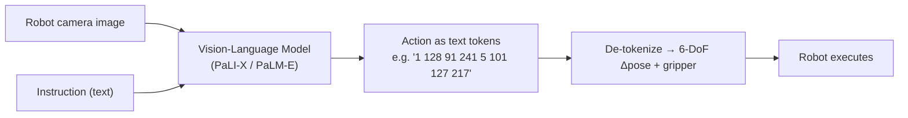

## 1. At a glance

**About.** Robot policies usually only know what's in their (small) robot dataset. RT-2
instead starts from a **vision-language model (VLM)** already trained on the web, and
**co-fine-tunes** it on robot demonstrations so it **outputs actions** — representing each
action as **text tokens** the model already emits. Result: web knowledge (objects,
concepts, reasoning) **transfers into control**, giving generalization a from-scratch
robot policy never gets. The authors call this a **vision-language-action (VLA)** model.

**Used:** pretrained **VLMs** (PaLI-X 5B/55B, PaLM-E 12B) · **actions-as-text-tokens** ·
**co-fine-tuning** on web VQA + robot demos together · constrained action decoding.

**Achieved ✓** — **~2× generalization** to unseen objects/backgrounds/instructions over
RT-1 (**62%** vs RT-1 **32%**, MOO 35%); **>3×** on "emergent" reasoning evals; new
abilities: symbol understanding, basic reasoning, person recognition, chain-of-thought
planning.

**Didn't ✗** — gains **no new physical motions** beyond the robot data (only recombines
known skills); **expensive inference** (55B runs at **1–3 Hz**), served from a **cloud**
TPU cluster over the network — not on-robot.

## 2. Building blocks

> [!warning] Background — general knowledge, not paper claims

- **VLM (vision-language model)** — a model trained on web images + text (captioning,
  VQA) that can describe images and answer questions about them (e.g. PaLI-X, PaLM-E).
- **Policy** — in robotics, the function mapping an observation (camera image + command)
  to an **action**.
- **6-DoF end-effector action** — how the gripper should move: 3 position + 3 rotation
  deltas, plus open/close and a "done" signal.
- **Tokenization** — turning something into discrete tokens from the model's vocabulary;
  here, continuous actions are binned into integers the LM can emit as text.

## 3. Architecture & method

**Big idea.** If a VLM already outputs text tokens, make **actions a dialect of text**.
Then fine-tuning for control is "just more language modeling", so the web knowledge in the
VLM's weights stays intact and transfers.

**Actions as tokens.** An action = 6-DoF end-effector displacement + gripper + a terminate
flag. Each continuous dimension is **discretized into 256 bins** → **8 integers** written
as a string. PaLI-X reuses its existing integer tokens; PaLM-E **overwrites its 256
least-used tokens**. At inference, decoding is **constrained** to valid action tokens.

**Co-fine-tuning (the crucial choice).** Train on **web VQA data and robot demos
*together*** (robot data ≈ **50%** of the PaLI-X mix, **66%** for PaLM-E) rather than
fine-tuning on robot data alone — this is what preserves web knowledge.

> [!key] Why co-fine-tuning (ground reality)
> Fine-tuning *only* on robot data makes the model forget its web knowledge. Ablation:
> 55B generalization is **63% with co-fine-tuning vs 52% fine-tune-only**, and **9%
> trained from scratch** — the web pretraining is doing most of the generalization work.

## 4. Training & data

- **Backbones** — RT-2-PaLI-X (**5B**, **55B**) and RT-2-PaLM-E (**12B**), all
  web-pretrained VLMs.
- **Robot data** — RT-1's demonstrations: **13 robots over 17 months** in an office
  kitchen (pick/place/move/manipulate).
- **Web data** — WebLI (~**10B** image-text pairs filtered to **~1B**) plus captioning/VQA
  sets, mixed in during co-fine-tuning.

## 5. Results, ablations & limitations

| Evaluation | RT-2 | Baselines |
| --- | --- | --- |
| Seen tasks | ≈ RT-1 | — |
| Unseen generalization | **62%** (PaLI-X-55B & PaLM-E-12B) | RT-1 **32%**, MOO **35%** |
| Emergent reasoning | **>3×** over RT-1 | — |

**Emergent capabilities.** Symbol/number understanding, simple reasoning about object
relations, person recognition, and **chain-of-thought** ("Plan: pick rxbar chocolate" for
"I'm hungry") — follow from the web knowledge, not the robot data.

**Ablation.** Co-fine-tune **63%** > fine-tune-only **52%** > from-scratch **9%** (55B);
bigger backbones generalize better.

**Limitations.** Learns **no new low-level motions** beyond the demos (recombines existing
skills); heavy inference (**1–3 Hz** for 55B, ~5 Hz for 5B) served from a **multi-TPU
cloud** over the network; few open VLMs available to build on.

## 6. Questions worth asking

- Generalization is semantic (what/where), not dynamical — how do you get *new physical
  skills* without more robot data?
- Can the action-as-tokens scheme capture fine, high-frequency control, or only coarse
  waypoints at 1–3 Hz?
- How far does co-fine-tuning scale — more web data, bigger VLM — before robot data is the
  bottleneck?
- It leans on a web-scale VLM in the lineage of [[clip-contrastive-language-image|CLIP]] /
  [[vision-transformer|ViT]] — what's the next capability a stronger VLM unlocks for control?
