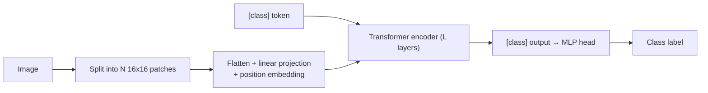

## 1. At a glance

**About.** Vision had been CNN territory; Transformers owned NLP. ViT asks: can a
**plain Transformer, with almost no vision-specific design**, classify images? Answer:
**yes — if you pretrain on enough data.** Slice the image into fixed patches, treat each
patch like a word token, and run the standard [[attention-is-all-you-need|Transformer]]
encoder.

**Used:** **patch embedding** (16×16 patches) · a learnable **[class] token** ·
**position embeddings** · standard Transformer encoder · large-scale pretraining.

**Achieved ✓** — ViT-H/14 hits **88.55%** ImageNet top-1 (ViT-L/16 **87.76%**), beating
the best CNNs (BiT **87.54%**) while using **~2–4× less** pretraining compute.

**Didn't ✗** — **data-hungry**: on ImageNet-only it *underperforms* CNNs and overfits,
because it **lacks CNN inductive biases** (locality, translation equivariance); detection
/ segmentation left as future work; self-supervised ViT still ~4% behind supervised.

## 2. Building blocks

> [!warning] Background — general knowledge, not paper claims

- **Inductive bias** — assumptions baked into an architecture. CNNs assume *locality*
  (nearby pixels relate) and *translation equivariance* (a cat is a cat anywhere). These
  are free priors that help when data is scarce.
- **Self-attention** — lets every patch look at every other patch directly (global
  context from layer 1), unlike a CNN's small, local receptive field.
- **[class] token** — an extra learnable "slot" prepended to the sequence; after the
  encoder, its vector is the whole-image summary fed to the classifier.

## 3. Architecture & method

**Big idea.** An image of `H×W` becomes `N = HW/P²` patches (P=16). Each patch is
flattened and linearly projected to a `D`-dim token — exactly a "word embedding", but for
image patches. Add position embeddings (so order isn't lost), prepend the `[class]`
token, and run a vanilla Transformer encoder (LayerNorm-pre, MSA + GELU-MLP, residuals).

**Variants.**

| Model | Layers | Hidden D | Heads | Params |
| --- | --- | --- | --- | --- |
| ViT-Base | 12 | 768 | 12 | 86M |
| ViT-Large | 24 | 1024 | 16 | 307M |
| ViT-Huge | 32 | 1280 | 16 | 632M |

Patch size matters: smaller patches (/14 vs /32) → longer sequences → more accurate but
costlier (ViT-B/16 **84.15** vs B/32 **80.73** on ImageNet).

> [!key] The core lesson: scale trumps inductive bias
> With little data, ViT's missing priors hurt and CNNs win. With enough pretraining
> data, ViT *learns* those priors from examples and overtakes CNNs — "large-scale
> training trumps inductive bias."

## 4. Training & data

- **Pretraining datasets** (the crossover driver): ImageNet-1k (1.3M) → ImageNet-21k
  (14M) → **JFT-300M** (303M). ViT loses to CNNs on the small end, wins on the big end.
- **Optimizer** — pretrain with **Adam** (β=0.9/0.999), batch **4096**, weight decay
  0.1; fine-tune with **SGD** (momentum 0.9), batch 512, often at **higher resolution**
  (512/518 px).
- **Compute** (TPUv3-core-days): ViT-H/14 **2.5k**, ViT-L/16 **0.68k** vs BiT-L **9.9k**.

## 5. Results, ablations & limitations

| Benchmark | ViT-H/14 (JFT) |
| --- | --- |
| ImageNet top-1 | **88.55%** |
| ImageNet ReaL | 90.72 |
| CIFAR-100 | 94.55 |
| VTAB (19 tasks) | 77.63 |

**Ablations.** Position-embedding *type* barely matters (1-D ≈ 2-D ≈ relative; only
"none" hurts) — the model mostly needs *some* position signal. `[class]` token vs global
average pooling perform similarly once the learning rate is tuned.

**Limitations.** Overfits more than ResNets on small data; self-supervised ViT reaches
79.9% (still ~4% behind supervised); detection/segmentation deferred; axial-attention
variants were slow on TPUs.

## 6. Questions worth asking

- Where exactly is the data-scale crossover, and does it move with better
  regularization or hybrid (conv-stem) designs?
- How much do the learned attention patterns actually recover locality vs. use global
  context?
- Can distillation (e.g. DeiT) remove the data hunger — i.e. is scale the *only* fix?
- This is the backbone image encoder in [[clip-contrastive-language-image|CLIP]] and
  robot VLMs like [[rt-2-vision-language-action|RT-2]] — what carries over?
