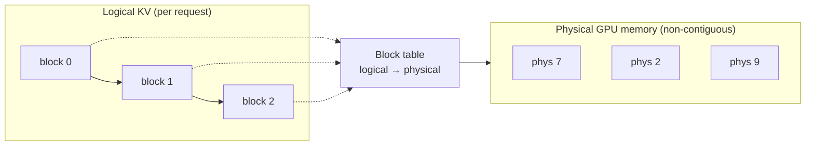

## 1. At a glance

**About.** When an LLM generates text, it stores a **KV cache** (the attention keys/values
for every token so far). It's huge and *grows as the response grows*. Existing servers
reserve one **contiguous, max-length** chunk per request → most of it sits empty
(**fragmentation**), so GPU memory — the thing that limits how many requests you can batch
— is wasted. vLLM borrows the OS idea of **paging**: chop the KV cache into **fixed-size
blocks** that can live **anywhere** in memory, tracked by a **block table**.

**Used:** **PagedAttention** (paged KV cache) · a **block table** (logical→physical) ·
**copy-on-write** sharing · the **vLLM** serving engine.

**Achieved ✓** — **2–4× throughput** over FasterTransformer and Orca at the **same
latency**; batches **2.2–4.3×** more requests; gains grow with longer sequences, bigger
models, and beam search (shared-prefix up to **3.58×**).

**Didn't ✗** — attention-kernel latency **20–26% higher** (block-table indirection); tiny
blocks make CPU↔GPU swapping expensive; the non-contiguous indirection could hurt
non-LLM, compute-bound workloads.

## 2. Building blocks

> [!warning] Background — general knowledge, not paper claims

- **KV cache** — to avoid recomputing attention over all previous tokens each step, the
  model caches their keys & values. Big and dynamic: OPT-13B is **800 KB per token**, so a
  2048-token request can need **1.6 GB**.
- **Fragmentation** — *internal*: reserved-but-unused space inside a block; *external*:
  unusable gaps between allocations. Both waste memory.
- **OS virtual memory / paging** — the OS trick of splitting memory into fixed **pages**
  mapped by a **page table**, so a process's memory needn't be physically contiguous.
- **Throughput vs latency** — throughput = requests/sec served; latency = time per
  request. Serving wants high throughput at acceptable latency.

## 3. Architecture & method

**The problem, precisely.** Measured: only **20.4–38.2%** of reserved KV memory held real
token state — i.e. **~62–80% wasted** — because systems pre-allocate a contiguous
max-length buffer per request, and can't share across sequences.

**PagedAttention.** Split each sequence's KV cache into fixed-size **blocks** (default
**16 tokens**) that need **not** be contiguous. A **block table** maps each logical block
to a physical one (pages↔blocks, tokens↔bytes, requests↔processes). External fragmentation
**disappears**; the only waste is the partially-filled **last block** → "near-zero waste".

**Memory sharing.** Because blocks are indirected, sequences can **share** them:

- **Copy-on-write** for parallel sampling / beam search — share the prompt's blocks, copy
  only a block that actually diverges (beam search saving **37.6–66.3%**).
- **Shared prefix** (system prompts) → **1.67×** (one-shot) to **3.58×** (few-shot)
  throughput.

**vLLM system.** A serving engine around PagedAttention: central scheduler, FCFS, and
**preemption** by swapping blocks to CPU or recomputing them under memory pressure.

> [!key] Why this is the standard now
> GPU memory, not compute, caps how many requests you can batch. Killing KV
> fragmentation lets you batch **far more** concurrent requests on the same GPU — which is
> exactly what raises serving throughput.

## 4. Setup & evaluation

- Models: OPT (13B–175B), LLaMA; workloads from **ShareGPT** (long, varied) and **Alpaca**
  (short).
- Baselines: **FasterTransformer** and **Orca** (Oracle / Pow2 / Max variants).
- Metric: sustainable request rate at a fixed latency SLO.

## 5. Results, ablations & limitations

| Comparison | Result |
| --- | --- |
| Throughput @ same latency | **2–4×** over FasterTransformer & Orca |
| ShareGPT vs Orca (Oracle) | **1.7–2.7×**; vs FasterTransformer up to **22×** |
| Requests batched (OPT-13B) | **2.2×** more than Orca-Oracle, **4.3×** more than Orca-Max |
| Beam search (width 6) | gain rises **1.3× → 2.3×** over Orca-Oracle |

Gains are **larger** with longer sequences, larger models, and more complex decoding —
exactly where KV memory pressure bites hardest.

**Limitations.** PagedAttention's attention kernel is **20–26% slower** than
FasterTransformer's (block-table access, branching, variable lengths) — but only on the
attention op; small block sizes make swapping (many tiny transfers) costly; the
indirection could hurt compute-bound non-LLM workloads.

## 6. Questions worth asking

- What's the right block size — the internal-fragmentation vs kernel-overhead trade-off?
- How much of real-world LLM-serving cost does prefix sharing (system prompts) actually
  save at scale?
- Paging solves KV *management*; [[flashattention|FlashAttention]] solves attention
  *compute* — how much do they stack?
- Architectures without a KV cache ([[mamba-selective-state-spaces|Mamba]]) would make
  this unnecessary — does that threaten the approach or just narrow it to Transformers?
